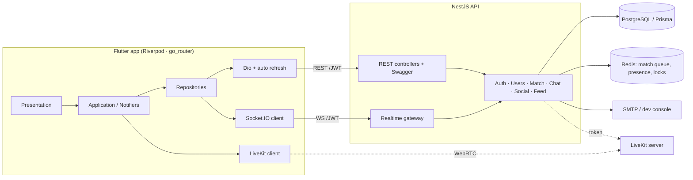

# Lumi — gặp gỡ người lạ, ẩn danh

Lumi là bản test kỹ thuật của một app ghép đôi ẩn danh kiểu "soul match": hai người lạ được ghép ngẫu nhiên và chat ẩn danh trong 3 phút. Nếu cả hai cùng thả tim thì thành bạn bè và chat 1‑1 realtime. Tên, logo và toàn bộ hình ảnh đều tự thiết kế (avatar "Lumi blob" và logo vẽ bằng code).

| Đăng nhập | Khám phá | Soul chat | Ghép đôi | Chat 1‑1 |
|---|---|---|---|---|
|  |  |  |  |  |

## Kiến trúc



## Tính năng

| | Trạng thái |
|---|---|
| Email + mật khẩu, mã xác thực 6 số, quên mật khẩu bằng mã | ✅ |
| JWT access + refresh (rotate, phát hiện dùng lại token), argon2, rate‑limit | ✅ |
| Onboarding: nickname, giới tính, ngày sinh (chặn <18), avatar, bio, sở thích | ✅ |
| Soul Match: hàng đợi Redis, lọc giới tính 2 chiều, chat ẩn danh có đếm ngược, thích/bỏ qua, cùng thích → bạn bè | ✅ |
| Danh sách bạn, chat 1‑1 realtime: đang gõ, đã xem, lịch sử, badge chưa đọc, online | ✅ |
| Báo cáo / chặn (cả trong phiên ẩn danh) | ✅ |
| Cài đặt: ngôn ngữ vi/en, người đã chặn, đăng xuất, xoá tài khoản | ✅ |
| Bảng tin + thả tim | ✅ |
| Voice Match (LiveKit) | ⚠️ đã code, cần một LiveKit server (có trong docker-compose) |
| Push FCM | ⚠️ stub (ghi log khi người nhận offline) |

## Chạy backend

**Cách nhanh, dùng Docker:**

```bash
docker compose up -d --build     # postgres, redis, livekit (dev), api :3000
open http://localhost:3000/docs  # Swagger
```

**Hoặc chạy trực tiếp** (Node 20+, cần sẵn Postgres 15+ và Redis 7):

```bash
cd backend
cp .env.example .env            # sửa DATABASE_URL / REDIS_URL nếu cần
npm ci
npx prisma migrate deploy
npm run build && npm run start:prod
npm run smoke                   # kịch bản E2E: 2 user đăng ký → match → chat
```

Ở môi trường dev:
- Khi `SMTP_HOST` để trống, mã xác thực được in ra console (`[DEV MAIL] ... code=123456`).
- Khi `DEV_EXPOSE_CODES=true`, API trả kèm `devCode` để app hiện banner chạm‑là‑điền. Production luôn tắt tính năng này.

**Test** (dùng DB `lumi_test` và Redis db 15):

```bash
npm test
```

Kết quả: auth, matching, chat e2e cùng unit test, 22/22 pass.

## Chạy app

```bash
cd mobile
flutter pub get
flutter run --dart-define=API_BASE_URL=http://10.0.2.2:3000            # Android emulator → máy host
flutter build apk --release --dart-define=API_BASE_URL=https://api.example.com
```

- `API_BASE_URL` mặc định là `http://10.0.2.2:3000`. Nếu chạy trên điện thoại thật, dùng IP LAN của máy chạy backend (ví dụ `http://192.168.1.10:3000`) hoặc domain HTTPS. Socket.IO dùng chung URL này.
- APK release ký bằng `android/key.properties` + keystore (đã gitignore). Nếu không có hai file này, build sẽ fallback sang debug key.
- iOS: `flutter build ios --release --no-codesign`. Workflow CI (`.github/workflows/ci.yml`) build backend, APK và IPA unsigned trên macOS. Muốn cài IPA lên iPhone thật thì cần Apple signing.

## Realtime (Socket.IO)

Xác thực qua `auth: { token: <accessToken> }`. Ack trả về `{ok, data}` hoặc `{ok:false, code, message}`.

| Client → server | Server → client |
|---|---|
| `match:join {mode}` · `match:leave` · `match:like` · `match:skip` | `match:found` · `match:liked` · `match:mutual` · `match:ended` |
| `soul:message` · `soul:typing` | `soul:message` · `soul:typing` |
| `chat:send` · `chat:typing` · `chat:read` | `chat:message` · `chat:typing` · `chat:read` · `presence:update` · `friends:changed` |

## Cấu trúc

```
backend/   NestJS + Prisma (src/auth, users, match, chat, social, feed, voice, realtime …, test/)
mobile/    Flutter (lib/core, lib/features/<feature>/{domain,data,application,presentation})
docs/      KE-HOACH.md/.docx, screenshots, smoke-test output
design/    script tạo icon
```
