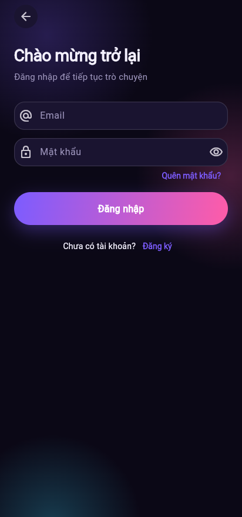
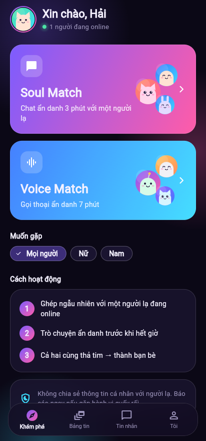
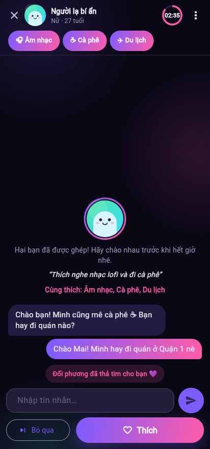
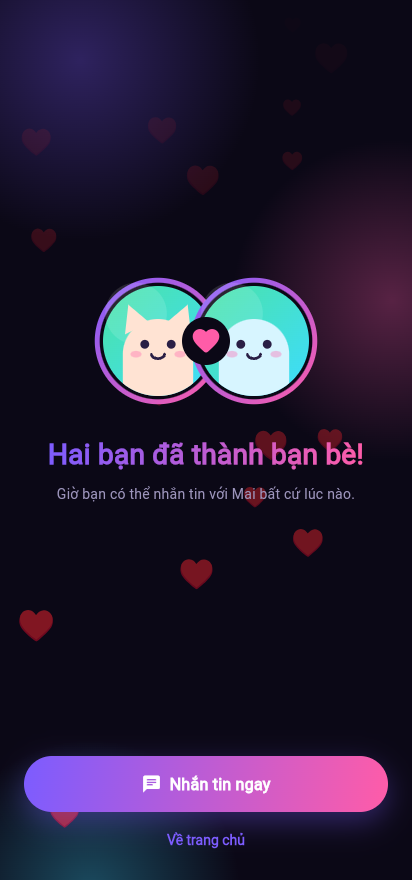
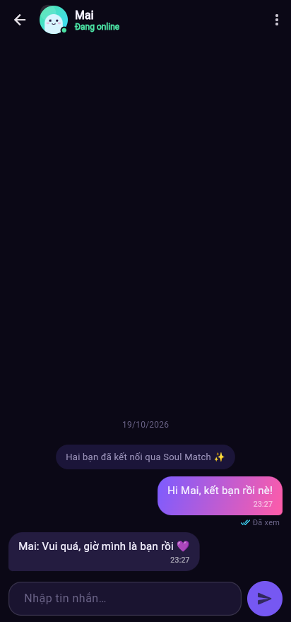
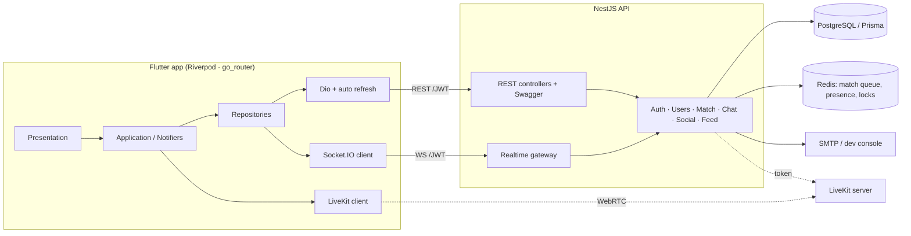

# Lumi — gặp gỡ người lạ, ẩn danh

Lumi là bản test kỹ thuật của một app ghép đôi ẩn danh kiểu "soul match": hai người lạ được ghép ngẫu nhiên và chat ẩn danh trong 3 phút. Nếu cả hai cùng thả tim thì thành bạn bè và chat 1‑1 realtime. Tên, logo và toàn bộ hình ảnh đều tự thiết kế (avatar "Lumi blob" và logo vẽ bằng code).

| Đăng nhập | Khám phá | Soul chat | Ghép đôi | Chat 1‑1 |
|---|---|---|---|---|
|  |  |  |  |  |

## Kiến trúc



## Tính năng

| | Trạng thái |
|---|---|
| Email + mật khẩu, mã xác thực 6 số, quên mật khẩu bằng mã | ✅ |
| JWT access + refresh (rotate, phát hiện dùng lại token), argon2, rate‑limit | ✅ |
| Onboarding: nickname, giới tính, ngày sinh (chặn <18), avatar, bio, sở thích | ✅ |
| Soul Match: hàng đợi Redis, lọc giới tính 2 chiều, chat ẩn danh có đếm ngược, thích/bỏ qua, cùng thích → bạn bè | ✅ |
| Danh sách bạn, chat 1‑1 realtime: đang gõ, đã xem, lịch sử, badge chưa đọc, online | ✅ |
| Báo cáo / chặn (cả trong phiên ẩn danh) | ✅ |
| Cài đặt: ngôn ngữ vi/en, người đã chặn, đăng xuất, xoá tài khoản | ✅ |
| Bảng tin + thả tim | ✅ |
| Bộ lọc độ tuổi (mặc định 18–99), áp dụng 2 chiều cho Soul/Voice Match và Người gần đây | ✅ v1.1 |
| Người gần đây: GPS tuỳ chọn, lưu vị trí làm tròn ~1 km (+geohash), chỉ hiện khoảng cách xấp xỉ “~3 km”, lọc bán kính/tuổi/giới tính, ẩn vị trí, “ưu tiên người gần đây” khi ghép | ✅ v1.1 |
| Chat đa phương tiện: ảnh (nén 1600px/q80), tin nhắn thoại giữ‑để‑ghi + phát lại, tệp đính kèm (≤20 MB, allowlist) | ✅ v1.1 |
| Gọi thoại thật qua LiveKit: Voice Match + gọi 1‑1 với bạn bè (đổ chuông, nghe/từ chối, tắt mic, loa ngoài) | ✅ v1.1 (cần LiveKit server, xem bên dưới) |
| Push FCM | ⚠️ stub (ghi log khi người nhận offline) |

## Chạy backend

**Cách nhanh, dùng Docker:**

```bash
docker compose up -d --build     # postgres, redis, livekit (dev), api :3000
open http://localhost:3000/docs  # Swagger
```

**Hoặc chạy trực tiếp** (Node 20+, cần sẵn Postgres 15+ và Redis 7):

```bash
cd backend
cp .env.example .env            # sửa DATABASE_URL / REDIS_URL nếu cần
npm ci
npx prisma migrate deploy
npm run build && npm run start:prod
npm run smoke                   # kịch bản E2E: 2 user đăng ký → match → chat
```

Ở môi trường dev:
- Khi `SMTP_HOST` để trống, mã xác thực được in ra console (`[DEV MAIL] ... code=123456`).
- Khi `DEV_EXPOSE_CODES=true`, API trả kèm `devCode` để app hiện banner chạm‑là‑điền. Production luôn tắt tính năng này.

**Test** (dùng DB `lumi_test` và Redis db 15):

```bash
npm test
```

Kết quả: auth, matching, chat, tuổi/vị trí/media/gọi thoại e2e cùng unit test, 53/53 pass (kèm test LiveKit sống khi có `LIVEKIT_TEST_URL`).

### LiveKit (gọi thoại)

Backend chỉ ký token (`livekit-server-sdk`); âm thanh đi qua LiveKit server. Khi thiếu biến môi trường, API trả `503 VOICE_UNAVAILABLE` và app hiện “Voice Match chưa được bật trên máy chủ”.

```bash
# Dev: tải binary https://github.com/livekit/livekit/releases rồi
livekit-server --dev --bind 0.0.0.0        # key=devkey secret=secret, ws://<host>:7880
# backend/.env
LIVEKIT_URL=ws://<IP-LAN-hoặc-domain>:7880   # URL mà ĐIỆN THOẠI kết nối được
LIVEKIT_API_KEY=devkey
LIVEKIT_API_SECRET=secret
```

Production: dùng LiveKit Cloud (`wss://<project>.livekit.cloud`) hoặc tự host (`livekit-server --config livekit.yaml`, mở TCP 7880/7881 + UDP 50000‑60000, TLS qua reverse proxy, key/secret mạnh). Test sống với server thật: `LIVEKIT_TEST_URL=ws://localhost:7880 npm test` (CI chạy sẵn `livekit-server --dev`).

### Lưu trữ tệp chat

`STORAGE_DRIVER=local` (mặc định) ghi vào `backend/uploads/` (đã gitignore). `STORAGE_DRIVER=s3` dùng mọi dịch vụ tương thích S3 (AWS S3, Cloudflare R2, MinIO, B2…): `S3_BUCKET`, `S3_REGION`, `S3_ENDPOINT`, `S3_ACCESS_KEY_ID`, `S3_SECRET_ACCESS_KEY`, `S3_FORCE_PATH_STYLE`. Giới hạn `MAX_UPLOAD_MB=20`.
Tải xuống `GET /attachments/:id` cần Bearer token của thành viên cuộc trò chuyện, hoặc URL ký HMAC ngắn hạn (`?exp&sig`, do API trả về trong mỗi tin nhắn) để widget ảnh/âm thanh tải được mà không cần header. Ảnh được kiểm tra magic bytes; tệp phải nằm trong allowlist MIME + đuôi; tên tệp được làm sạch.

### Tin nhắn lưu trên thiết bị (v1.2, store‑and‑forward kiểu WhatsApp)

- **Máy chủ không giữ lịch sử.** Mỗi tin nhắn (và tệp đính kèm) chỉ nằm trên server trong hàng đợi của người nhận (`Message.recipientId`, `expiresAt`). Khi thiết bị người nhận đã lưu tin nhắn và tải xong tệp, nó gửi ack (`chat:ack` qua socket hoặc `POST /messages/ack {ids}`), server **xoá hàng trong DB và blob tệp** ngay, rồi báo `chat:delivered` cho người gửi (✓ Đã nhận). Biên nhận đã xem (`chat:read`) vẫn hoạt động.
- Thiết bị nhận hàng đợi khi kết nối (server đẩy `chat:pending`) và qua REST `GET /messages/pending` (lặp tới khi hết). `GET /conversations/:id/messages` đã bị **gỡ bỏ**.
- Tin chưa giao được quá `MESSAGE_TTL_DAYS` (mặc định 30) bị job dọn dẹp xoá (`PURGE_INTERVAL_MINUTES`, mặc định 60), kèm các upload mồ côi.
- **App:** lịch sử nằm trong SQLite mã hoá SQLCipher (`sqflite_sqlcipher`), khoá 256‑bit ngẫu nhiên lưu trong Keychain/Keystore (`flutter_secure_storage`), mỗi tài khoản một DB; tệp đã tải/đã gửi lưu trong thư mục documents của app. Giao diện chat đọc từ DB cục bộ nên xem được khi offline. Đăng xuất: chọn **Giữ lại** hoặc **Xoá khỏi máy**; xoá tài khoản luôn xoá dữ liệu cục bộ.
- ⚠️ **Không đồng bộ nhiều thiết bị.** Mất máy, cài lại app hoặc đổi điện thoại ⇒ mất lịch sử, trừ khi đã sao lưu. Cài đặt → *Xuất bản sao lưu* tạo tệp JSON (chỉ chữ và metadata, **không** kèm tệp đính kèm, **không mã hoá** – hãy giữ cẩn thận) và *Nhập bản sao lưu* để khôi phục.
- Tin nhắn đang ở server trước khi giao vẫn ở dạng rõ (chưa mã hoá đầu‑cuối); E2EE là bước tiếp theo nếu cần.

### API mới (v1.1)

| | |
|---|---|
| `PATCH /me {agePrefMin, agePrefMax, locationHidden}` | tuỳ chọn ghép |
| `PUT /me/location {lat,lng}` · `DELETE /me/location` | lưu vị trí đã làm tròn ~1 km (toạ độ gốc bị bỏ ngay) |
| `GET /nearby?radiusKm&minAge&maxAge&gender` | người gần đây, trả `distanceKm` xấp xỉ, không bao giờ trả toạ độ |
| `GET /messages/pending` · `POST /messages/ack {ids}` (v1.2) | nhận hàng đợi / xác nhận đã lưu → server xoá |
| `POST /conversations/:id/media` (multipart `file`, `kind`=IMAGE/VOICE/FILE, `durationMs`, `width`, `height`, `caption`, `clientId`) | gửi tin nhắn media |
| `GET /attachments/:id` | tải tệp (Bearer hoặc URL ký) |
| `POST /calls {conversationId}` · `/calls/:id/accept` · `/decline` · `/end` | gọi 1‑1 với bạn bè, trả token LiveKit |

## Chạy app

```bash
cd mobile
flutter pub get
flutter run --dart-define=API_BASE_URL=http://10.0.2.2:3000            # Android emulator → máy host
flutter build apk --release --dart-define=API_BASE_URL=https://api.example.com
```

- `API_BASE_URL` mặc định là `http://10.0.2.2:3000`. Nếu chạy trên điện thoại thật, dùng IP LAN của máy chạy backend (ví dụ `http://192.168.1.10:3000`) hoặc domain HTTPS. Socket.IO dùng chung URL này.
- APK release ký bằng `android/key.properties` + keystore (đã gitignore). Nếu không có hai file này, build sẽ fallback sang debug key.
- iOS: `flutter build ios --release --no-codesign`. Workflow CI (`.github/workflows/ci.yml`) build backend, APK và IPA unsigned trên macOS. Muốn cài IPA lên iPhone thật thì cần Apple signing.

## Realtime (Socket.IO)

Xác thực qua `auth: { token: <accessToken> }`. Ack trả về `{ok, data}` hoặc `{ok:false, code, message}`.

| Client → server | Server → client |
|---|---|
| `match:join {mode}` · `match:leave` · `match:like` · `match:skip` | `match:found` · `match:liked` · `match:mutual` · `match:ended` |
| `soul:message` · `soul:typing` | `soul:message` · `soul:typing` |
| `chat:send` · `chat:typing` · `chat:read` | `chat:message` · `chat:typing` · `chat:read` · `presence:update` · `friends:changed` |
| `match:join {mode, gender, preferNearby}` · `chat:ack {ids}` · `chat:pending` | `call:incoming` · `call:accepted` · `call:ended` · `chat:pending` · `chat:delivered` |

## Cấu trúc

```
backend/   NestJS + Prisma (src/auth, users, match, chat, social, feed, voice, realtime …, test/)
mobile/    Flutter (lib/core, lib/features/<feature>/{domain,data,application,presentation})
docs/      KE-HOACH.md/.docx, screenshots, smoke-test output
design/    script tạo icon
```
