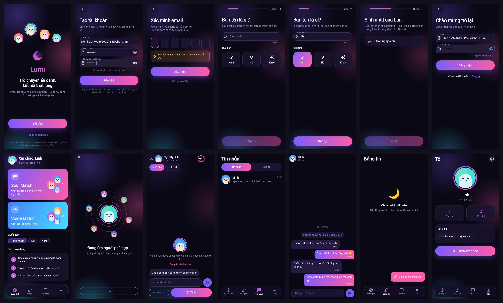
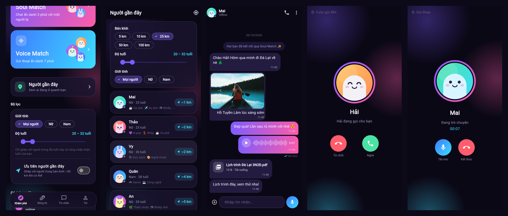
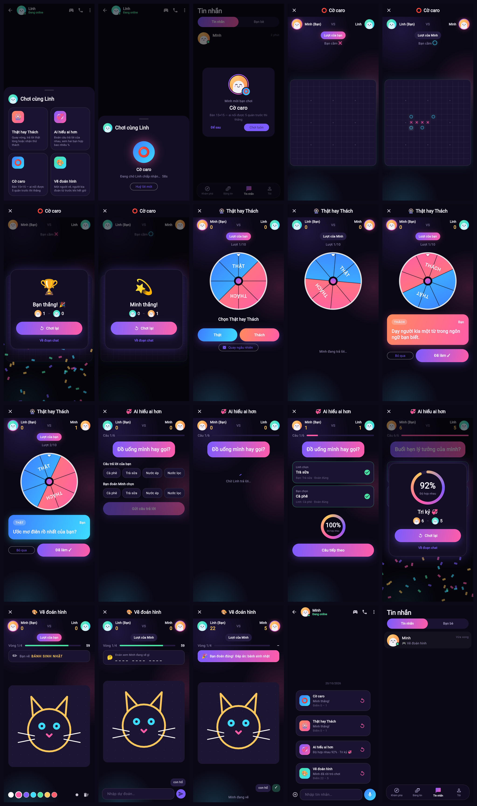

<div align="center">

# 💜 Lumi

**Connect soul first, looks second.**

A dating & friendship app with Soul Match, Voice Match, on-device encrypted chat, and mini games for couples.

[**⬇️ Download the app**](https://github.com/gooduselabs/lumi-app/releases)

</div>

---

## ✨ Features

- 🔮 **Soul Match** — get matched by personality and interests, and chat anonymously before revealing yourself.
- 🎙️ **Voice Match** — meet people through their voice, plus voice/video calls with friends (LiveKit).
- 🎯 **Age & Nearby filters** — find compatible people around you (location is coarsened to protect your privacy).
- 🖼️ **Media chat** — send photos, voice messages, and files.
- 🔐 **On-device encrypted messages** — history is stored locally with SQLCipher; the server deletes messages once delivered.
- 🎮 **Couple mini games** — Truth or Dare · Who Knows Whom Better · Caro (Gomoku) · Draw & Guess.

## 📸 Screenshots

| Discover & Match | Filters, Chat & Calls | Mini Games |
|:---:|:---:|:---:|
|  |  |  |

## 🛠️ Tech Stack

| Layer | Technology |
|---|---|
| Mobile | Flutter |
| Backend | NestJS · Prisma · PostgreSQL · Redis |
| Realtime | Socket.IO |
| Voice/Video calls | LiveKit |

## 🚀 Quick Start (dev)

```bash
docker compose up -d          # Postgres, Redis, LiveKit (dev keys)
cd backend && cp .env.example .env && npm i && npx prisma migrate dev && npm run start:dev
cd ../mobile && flutter run
```

## 📥 Download

Latest APK: **https://github.com/gooduselabs/lumi-app/releases/latest/download/lumi-1.3.0-arm64-v8a.apk** (all releases: https://github.com/gooduselabs/lumi-app/releases)
